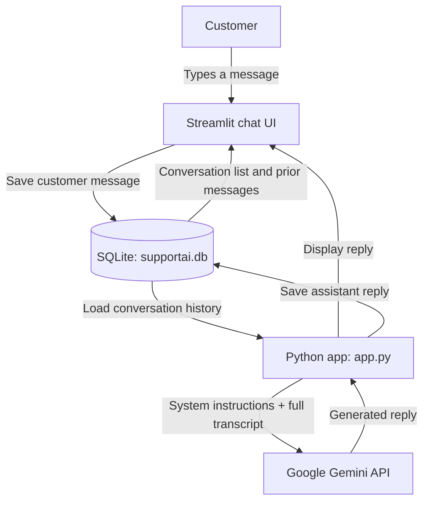

# SupportAI

SupportAI is a Streamlit customer-service chatbot powered by Google's Gemini API. It provides a chat interface for common support topics and stores conversation history locally in SQLite.

## Features

- Customer support for orders and delivery, payments and billing, returns and refunds, product information, account assistance, and technical support.
- Persistent conversation history with automatic titles based on the first customer message.
- Create, reopen, and delete conversations from the sidebar.
- A system prompt that guides the assistant to be helpful, avoid inventing order or policy details, and never request passwords or OTPs.
- Local SQLite storage; no separate database server is needed.

## Architecture and message flow



### Main components

| Component | Responsibility |
|---|---|
| `app.py` | Configures the Streamlit page, renders the chat and sidebar, manages session state, and coordinates database and Gemini operations. |
| Google Gemini API | Generates assistant replies from the support instructions and the selected conversation's transcript. |
| `supportai.db` | Stores conversations and messages in two SQLite tables. The app creates the tables automatically when it starts. |

### Database tables

- `conversations`: conversation ID, title, creation time, and last-updated time.
- `messages`: message ID, conversation ID, role (`user` or `assistant`), content, and creation time.

The database path is relative to the directory from which Streamlit is launched. The app loads the full conversation history to provide context for each Gemini request.

## Requirements

- Python
- A Google Gemini API key
- The Python packages listed in [`requirements.txt`](requirements.txt)

## Run locally

1. Clone or download this project and open a terminal in its root directory.
2. Create and activate a virtual environment (recommended):

   ```powershell
   python -m venv .venv
   .\.venv\Scripts\Activate.ps1
   ```

   On macOS or Linux, activate it with:

   ```bash
   source .venv/bin/activate
   ```

3. Install dependencies:

   ```bash
   python -m pip install -r requirements.txt
   ```

4. Set `GEMINI_API_KEY` in your environment. For the current PowerShell session:

   ```powershell
   $env:GEMINI_API_KEY = "your-gemini-api-key"
   ```

   On macOS or Linux:

   ```bash
   export GEMINI_API_KEY="your-gemini-api-key"
   ```

5. Start the app:

   ```bash
   streamlit run app.py
   ```

   Streamlit prints a local URL to open in your browser.

## Configuration

- **API key:** Read from the `GEMINI_API_KEY` environment variable. The app stops with an error if it is missing.
- **Model:** Set in `app.py` as `gemini-3.5-flash-lite`.
- **Conversation storage:** SQLite database at `supportai.db` in the current working directory. The file and tables are created automatically if needed.

## Privacy and deployment notes

- Customer messages and assistant replies are saved unencrypted in the local SQLite database. Do not publish a database containing real conversations.
- The selected conversation's full transcript is sent to Google Gemini to generate each reply. Avoid entering sensitive personal, payment, password, or one-time-code information.
- Keep the API key out of source control. Configure it as an environment variable or use your hosting provider's secret manager.
- This project has no user authentication or authorization. The local SQLite setup is intended for local/demo use; assess privacy, access control, data retention, and deployment needs before hosting it for multiple users.

## GitHub checklist

- Commit `app.py`, `README.md`, and `requirements.txt`.
- Do not commit `supportai.db`, virtual environments, or API keys.
- Add project-specific screenshots to the README if you want to showcase the UI.
